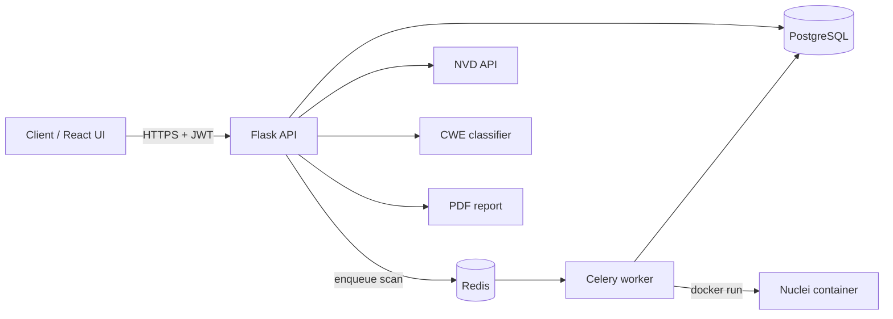
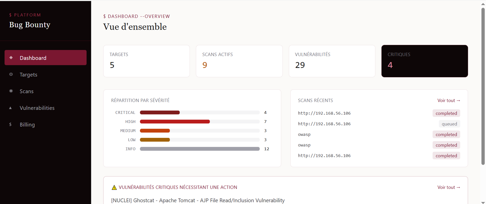
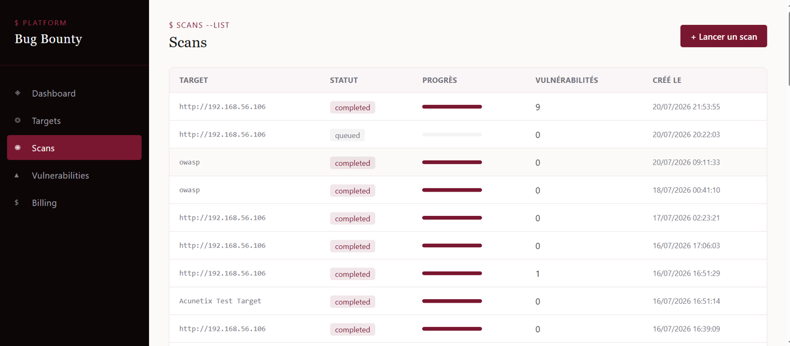
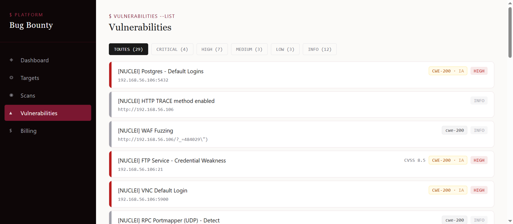
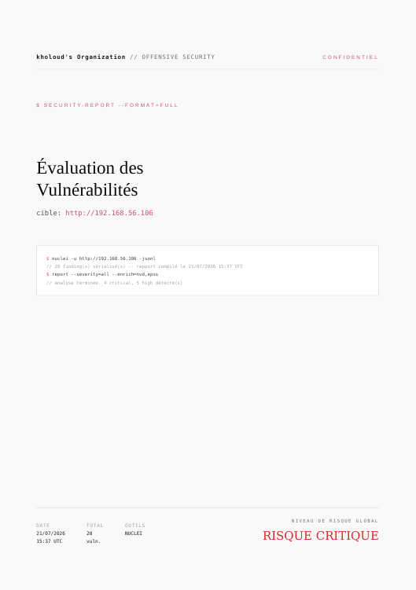
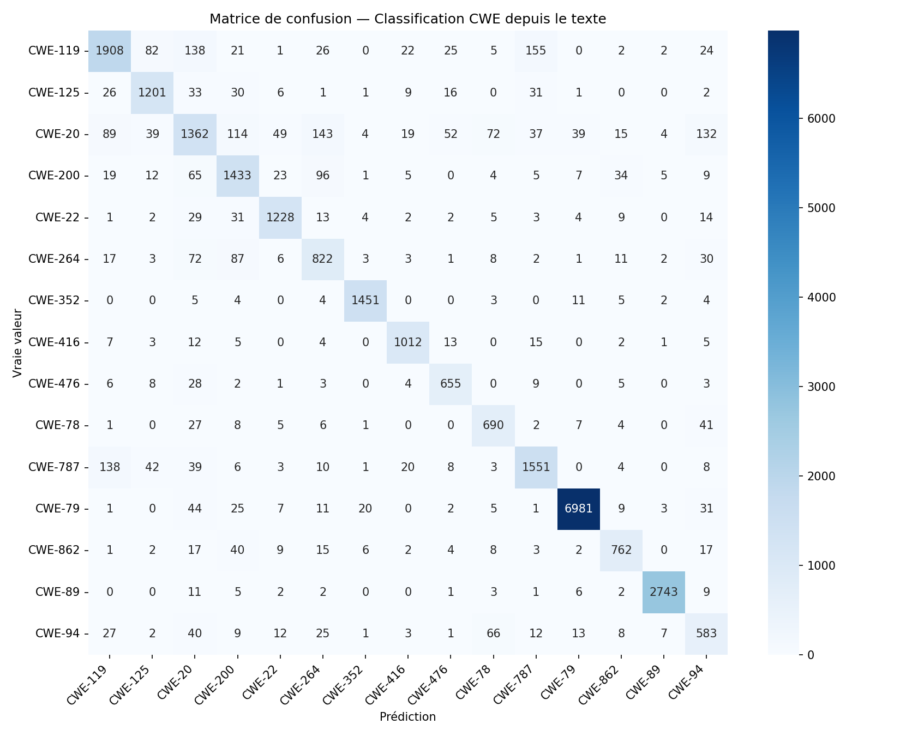

# Bug Bounty Automation Platform

A multi-tenant SaaS backend that automates the repetitive parts of vulnerability hunting: it runs
[Nuclei](https://github.com/projectdiscovery/nuclei) scans asynchronously inside isolated Docker containers,
enriches findings with CVE data from the NVD, predicts the weakness class (CWE) of a vulnerability with a
machine-learning model, and produces PDF security reports.

Built as my second-year engineering end-of-year project (PFA) at ISMAGI, supervised by Prof. Khalil Boukri.

> **Legal notice:** scan only systems you own or are explicitly authorized to test.
> The author is not responsible for misuse.

## Features

- **Authentication and access control**: JWT stored in httpOnly cookies with CSRF double-submit protection
  (SameSite=Lax, Secure in production), organizations, users and role-based permission checks.
- **Asynchronous scanning**: scan requests are queued with Celery and Redis, then executed by Nuclei in
  a dedicated Docker container per scan (all Linux capabilities dropped, CPU and memory limits, hard timeout, named and labeled containers).
- **Vulnerability management**: targets, scans, findings, deduplication and status tracking.
- **CVE enrichment**: NVD API integration with a local cache.
- **ML-based CWE classification**: TF-IDF + LinearSVC trained on CVE descriptions (see results below).
- **Bounty tracking**: records related to bug bounty submissions.
- **PDF reports**: generated per scan.
- **Billing**: Stripe integration with plan-based limits (free / starter / pro / enterprise), test mode.
- **API hardening**: rate limiting with Flask-Limiter (for example 5 login attempts per minute and 3 registrations per hour), security headers with Flask-Talisman, passwords hashed with PBKDF2-SHA256, and API keys stored only as SHA-256 hashes.
- **React web interface**: seven pages with protected routes and live scan-status polling (see below).

The REST API exposes about 70 routes (auth, organizations, targets, scans, vulnerabilities, reports,
bounties, billing, events).

## Architecture



## Web interface

| Page | Route | Purpose |
|---|---|---|
| Login / Register | `/login`, `/register` | Authentication; account and organization creation |
| Dashboard | `/dashboard` | Targets, vulnerabilities by severity, latest scans |
| Targets | `/targets` | Manage targets, launch scans, download the PDF report |
| Scans | `/scans` | Real-time scan status (polling) and history |
| Vulnerabilities | `/vulnerabilities` | Filter by severity, status and target; CVSS and EPSS details |
| Billing | `/billing` | Subscription plans and Stripe Checkout |

### Screenshots





Sample PDF report (cover page), generated for a lab target:



## Subscription plans

Limits are defined in one place, `backend/app/config/plan_limits.py`.

| Plan | Price | Scans / day | Targets | Members | Scan timeout |
|---|---|---|---|---|---|
| Free | $0 | 3 | 5 | 1 | 15 min |
| Starter | $9 | 5 | 25 | 5 | 20 min |
| Professional | $29 | 20 | 100 | 50 | 30 min |
| Enterprise | $99 | 999 | 1,000 | 500 | 60 min |

## Tech stack

| Layer | Technologies |
|---|---|
| API | Flask 3, SQLAlchemy 2, Flask-Migrate (Alembic), Flask-JWT-Extended, Flask-CORS |
| Async jobs | Celery 5, Redis |
| Database | PostgreSQL (SQLite for the smoke test) |
| Scanning | Nuclei in Docker (`projectdiscovery/nuclei`) |
| ML | scikit-learn (TF-IDF vectorizer + LinearSVC) |
| Frontend | React 19, Vite, React Router, Axios, Tailwind CSS |
| Payments | Stripe (test mode) |

## Machine-learning model

The classifier predicts the CWE of a CVE from its description.

| Metric | Value |
|---|---|
| Classes | 15 most frequent CWEs |
| Training / test samples | 110,437 / 27,610 |
| Accuracy | 88.3 % |
| F1 (weighted / macro) | 0.883 / 0.852 |
| 5-fold cross-validation accuracy | 0.883 ± 0.002 |

Weakest classes: CWE-20 (improper input validation) and CWE-94 (code injection), which overlap semantically
with other injection classes. Details: [`docs/ml/metrics_summary_cwe.json`](docs/ml/metrics_summary_cwe.json)
and the confusion matrix below.



The trained model and vectorizer are included in `backend/app/ml_models/`. The training dataset (about 98 MB)
is not stored in this repository: place your CVE/CWE CSV at `backend/app/ml_models/CVE_CWE_2025.csv` to retrain.

## Validation

Documented in the project report: real scans against deliberately vulnerable targets
(Metasploitable2 and DVWA) identified 29 vulnerabilities, 7 of which were CVEs enriched automatically through NVD and EPSS.

## Getting started

### Development setup used in the project

The API runs on a Windows host (port 5001). Redis, the Celery worker, Docker/Nuclei and the Vite dev server run in an
Ubuntu virtual machine on a host-only network. PDF reports (WeasyPrint) are generated by the Linux worker.
Everything can also run on a single Linux machine.

### Prerequisites

Python 3.10+, PostgreSQL, Redis, Docker, Node.js 18+ (for the frontend).
PDF reports use WeasyPrint, which needs the Pango/GTK system libraries (see the [WeasyPrint documentation](https://doc.courtbouillon.org/weasyprint/stable/first_steps.html) for your OS).

### Backend

```bash
cd backend
python -m venv venv
venv\Scripts\activate          # Windows (PowerShell: venv\Scripts\Activate.ps1)
# source venv/bin/activate     # Linux / macOS
pip install -r requirements.txt

cp .env.example .env           # then edit .env with your own values
flask run --port 5001          # in development mode, missing tables are created automatically at startup
```

> The `migrations/` folder contains an Alembic migration that adds the CWE columns to an existing `vulnerabilities` table.
> It is not needed for a fresh development database.

In a second terminal, start the Celery worker:

```bash
cd backend
CELERY_WORKER=1 celery -A celery_app:celery worker --loglevel=info
```

`CELERY_WORKER=1` tells `celery_app.py` that it is running inside a worker process (the Flask process must not set it).
The worker needs Redis and Docker. On Windows, run it in WSL or a Linux VM; to start it from PowerShell instead:

```powershell
$env:CELERY_WORKER = "1"
python -m celery -A celery_app.celery worker --loglevel=info --pool=solo
```

### Quick check without PostgreSQL or Redis

```bash
cd backend
python smoketest.py            # runs against a temporary SQLite database
```

### Frontend

```bash
cd frontend
npm install
npm run dev
```

In development, Vite proxies every `/api/*` request to the Flask backend, so the browser sees a single origin and the
httpOnly cookies are sent without SameSite problems. Set the backend address in `frontend/.env`
(see `frontend/.env.example`), for example `VITE_PROXY_TARGET=http://localhost:5001`, and run Flask with
`flask run --port 5001`.

## Project status and roadmap

- [x] Core API: authentication, organizations, targets, scans, vulnerabilities, reports
- [x] Dockerized Nuclei scanning with resource limits and timeouts
- [x] CVE enrichment and CWE classification
- [x] React interface (7 pages) with cookie-based authentication
- [ ] Automated test suite (pytest) and CI
- [ ] `docker-compose.yml` for one-command setup
- [ ] Target ownership verification before scanning (DNS TXT or file token)

## Security notes

Secrets are loaded from environment variables and `.env` files are git-ignored. Stripe is used in test mode only.
Flask-Limiter uses in-memory storage by default: point it at Redis (`RATELIMIT_STORAGE_URI`) before any production use. Redis itself should be password-protected and bound to the internal network only.
If you deploy this project, set strong `SECRET_KEY` and `JWT_SECRET_KEY` values and restrict who can start scans:
a scanning service can be abused against third-party systems.

## Author

**Khouloud Moumni**, cybersecurity engineering student at ISMAGI (Morocco), class of 2027.
[LinkedIn](https://www.linkedin.com/in/khouloud-moumni-346a4b2a6) · [GitHub](https://github.com/clouds-K)

## License

[MIT](LICENSE)
